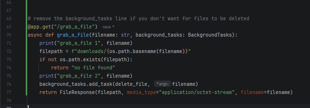

# Python FastAPI YTMP(YTMP3) 
## A fully working dockerized app for downloading .mp3 and .mp4 files in the highest quality from YouTube.

As this project uses ~~[pytubefix]([pytubefix](https://github.com/JuanBindez/pytubefix/))~~ [yt_dlp]([yt_dlp](https://github.com/yt-dlp/yt-dlp/)), 
it requires Node or Deno (or both for stability), both of which are included in the `Dockerfile`.
FFmpeg is also used.

to stop files from being deleted, you should remove the line 152 from the `grab_a_file` 
function(`delete_file.delay(filename=filename)`), line 76 in the picture below:

and remove the line 29(`shutil.rmtree(downloads_folder)`), both are in the `ytmp3.py` file.

The folder all the files are temporarily downloaded into can be modified at the beginning of the
`fastapi-ytmp3-working-dir/ytmp3.py` file (`downloads_folder` variable).

You can change the amount of time after which files are deleted in the `delete_file` function, the `await asyncio.sleep(600)` line. 
They will however still be deleted after the app shuts down unless you remove the line 29 of the `ytmp3.py` file. 

