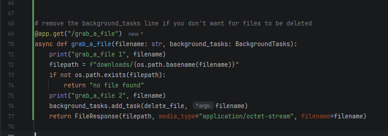

as this project uses ~~[pytubefix]([pytubefix](https://github.com/JuanBindez/pytubefix/))~~ [yt_dlp]([yt_dlp](https://github.com/yt-dlp/yt-dlp/)), 
i'm pretty sure it needs node.js for automatic PoToken generation, so you'll have to install it on your PC. 
Or use the Docker version, since it does install it automatically. 

also you have to install ffmpeg for the app to work correctly, and you could install deno for fewer hiccups

to stop files from being deleted, you gotta manually change `grab_a_file` function(line 76):

The folder all the files are temporarily downloaded into can be modified at the beginning of 
`fastapi-ytmp3-working-dir/ytmp3.py` file (`downloads_folder` variable).

You can disable downloaded items being deleted after a while by removing `background_tasks.add_task(delete_file, filename)` on line 139, in the 
`grab_a_file` function. 

You can change the amount of time after which files are deleted in the `delete_file` function, the `await asyncio.sleep(600)` line. 
Naturally, if you stop the app before the files are deleted they will not be deleted automatically. 

